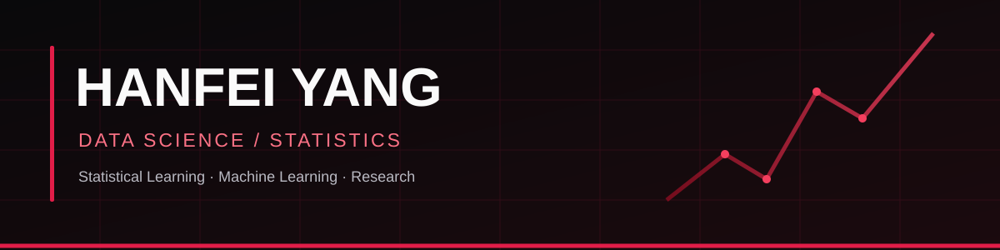

**STATISTICAL LEARNING** &nbsp;·&nbsp; **MACHINE LEARNING** &nbsp;·&nbsp; **APPLIED STATISTICS**

[Email](mailto:yanghanfei@arizona.edu) &nbsp;·&nbsp; [GitHub](https://github.com/Hanfei-Yang) &nbsp;·&nbsp; [Research](#02--featured-research)

---

### 01 / ABOUT

I am an undergraduate student in **Data Science and Statistics** in the **Capital University of Economics and Business–University of Arizona dual-degree program**, with a minor in **Computer Science** at the University of Arizona.

My interests include **statistical learning, machine learning, model evaluation, and applied statistical inference**. I am particularly interested in developing and evaluating methods for complex real-world datasets, including noisy labels and heterogeneous populations.

**Education**

- **University of Arizona** — B.S. in Data Science; Minor in Computer Science · Aug 2025–Present
- **Capital University of Economics and Business** — Statistics, CUEB–UA Dual-Degree Program · Sep 2023–Jun 2025
- **University of Manchester** — *Digital Economy: AI and the Business*, Alliance Manchester Business School · Summer 2025

**Academic recognition:** Dean's List with Distinction (Spring 2026); Dean's List (Fall 2025); Academic Excellence Scholarship (2025).

---

### 02 / FEATURED RESEARCH

#### PU-Boost — Positive–Unlabeled Learning for Hypertension Screening

**Co-author / Research Assistant** · 2026 · Under Review  
[Research preprint](https://doi.org/10.64898/2026.10.04.26364708) · [Project repository](https://github.com/LionelWu11282562/A-Two-Stage-Probability-Stratified-Method-for-Ambiguous-Dataset-Optimization)

A two-stage positive–unlabeled (PU) learning framework for identifying undiagnosed hypertension among **43,105 Chinese adults**, designed to address uncertain labels in heterogeneous population data.

- **Approach:** Elastic Net logistic regression and Random Forest for sample reconstruction and stratification, followed by XGBoost classification.
- **Evaluation:** Sensitivity of **0.817**, with **41.1% fewer false negatives** than standard XGBoost; considered the corresponding trade-offs in specificity.
- **Interpretation:** SHAP analysis to examine contributors to model predictions.

`Positive–Unlabeled Learning` `Elastic Net` `Random Forest` `XGBoost` `SHAP`

---

### 03 / ADDITIONAL RESEARCH & PROJECTS

#### Heterogeneous Effects of Local Government Financing Channels on Industrial Structure

**Co-author** · 2026 · Under Review · [Preprint](https://doi.org/10.31235/osf.io/3waq5_v2)

Studied the heterogeneous associations of statutory government debt and local government financing vehicle (LGFV) debt with industrial structure using **2016–2025 Chinese provincial panel data**. Contributed to software implementation, **two-way fixed effects modeling**, robustness checks, and manuscript revision.

`Panel Data` `Two-Way Fixed Effects` `Robustness Checks`

#### Systolic Blood Pressure Among Chinese Adults

**Statistical Analyst** · Fall 2025 · [Project repository](https://github.com/Hanfei-Yang/SystolicBlood-Pressure-Among-Middle-Agedand-Older-Chinese-Adults)

Analyzed **43,088 observations** and **48 initial clinical variables**, using **LASSO**, collinearity diagnostics, nested multivariate linear models, logistic regression, and Box–Cox transformations to study factors associated with blood pressure.

`LASSO` `Regression` `Statistical Inference` `R`

---

### 04 / INDUSTRY EXPERIENCE

#### Product Research & Development Intern — Beijing Yolosho Technology Co., Ltd.

**July–August 2026**

- Helped refine an **AI-powered résumé screening system**, improving internal screening accuracy from approximately **83% to over 90%** through collaborative model and scoring improvements.
- Used statistical analysis, including **logistic regression**, to investigate differences between stated HR criteria and actual screening decisions.
- Developed **Sankey diagrams** and **sunburst charts** for a career-guidance platform, and contributed to product improvements informed by client feedback.

`Machine Learning` `Statistical Analysis` `Product R&D` `Data Visualization`

---

### 05 / TECHNICAL SKILLS

| Area | Tools & methods |
| :--- | :--- |
| **Programming** | Python (NumPy, pandas), R (statistical modeling, R Markdown), Java, SQL, C (basics) |
| **Statistical methods** | Regression, statistical inference, variable selection, panel-data analysis |
| **Machine learning** | Classification, tree-based models, model validation, positive–unlabeled learning |
| **Visualization** | Statistical graphics, Sankey diagrams, sunburst charts |

---

### 06 / HONORS & CERTIFICATIONS

- **Dean's List with Distinction** — University of Arizona, Spring 2026
- **Dean's List** — University of Arizona, Fall 2025
- **Academic Excellence Scholarship** — Capital University of Economics and Business, 2025
- **Certificate of Completion** — Alliance Manchester Business School, 2025
- **Professional Competency Certificate in Market Research & Analysis** — China, 2024

---

### 07 / CONTACT

**[yanghanfei@arizona.edu](mailto:yanghanfei@arizona.edu)** &nbsp;·&nbsp; **[GitHub](https://github.com/Hanfei-Yang)**

Hanfei Yang · Data Science & Statistics

